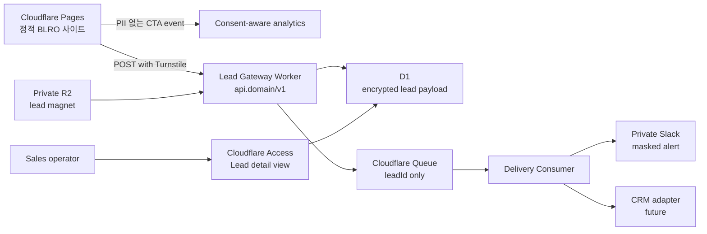

# BLRO 리드발굴 엔진 상세 구현 계획서

## 1. 구현 목표와 완료 정의

### 목표

정적 BLRO 웹사이트가 검색·콘텐츠 유입을 받고, 고객이 주제별 전환 진단 상담 또는 체크리스트 요청을 완료하며, 개인정보를 보호한 상태로 영업이 유효 미팅·기회 전환을 기록할 수 있게 한다.

### 출시 완료 정의

- 운영 도메인에서 공개 route, canonical, sitemap, robots, JSON-LD가 일관되게 동작한다.
- 고객/파트너/벤더 CTA가 구현된 `/contact` route로 이동하고 topic·CTA가 보존된다.
- valid lead는 단 한 번 저장·전달되고, invalid·spam·duplicate·delivery failure는 정의된 상태로 처리된다.
- preview는 noindex와 synthetic sink를 사용하고 실제 PII·운영 Slack을 사용하지 않는다.
- 승인 콘텐츠만 SEO·사이트맵·외부 배포 후보가 된다.

### 이번 범위 제외

- 광고 집행, 이메일 마케팅 자동화, CRM 판매 파이프라인의 완전 구현
- 고객 채팅, 로그인, 포털, 결제
- 법무·사업 승인 전 실제 PII 수집·외부 수신자·운영 도메인 연결

## 2. 결정 게이트 G0

아래 네 항목은 코드로 추측하지 않는다. 확정 전에는 preview/mock까지만 구현하고 production PII 수집을 차단한다.

| 결정 | 권장안 | 승인자 | 후속 영향 |
| --- | --- | --- | --- |
| 운영 도메인 | BLRO 소유 도메인 1개를 canonical로 확정 | 사업 책임자 | Pages custom domain, metadata, Search Console, Naver |
| 개인정보 처리 | 목적·항목·90일 보관 기본안·수탁/국외이전·권리 요청 확정 | Privacy owner | `/privacy`, D1, Slack/CRM, retention job |
| 리드 수신 | private `#blro-leads` + Access 보호 조회, CRM은 adapter로 후속 | Inquiry owner | Worker secrets, channel membership, SLA |
| 첫 전환 자산 | VMware 전환·HCI 사전진단 체크리스트 | Content/technical approver | R2 파일, download route, CTA |

## 3. 목표 아키텍처



### 환경 분리

| 환경 | Pages | Lead Gateway | 저장/전달 | 색인 |
| --- | --- | --- | --- | --- |
| Local | Next dev 또는 static preview | local Worker test binding | fake adapter | noindex |
| Preview | Pages preview branch | preview Worker | fixture/synthetic sink만 | noindex |
| Production | custom domain | production Worker | encrypted D1 + Queue + private Slack | index |

## 4. 구현 카드와 파일 범위

### P1-A. SEO foundation

**목적:** indexable route의 발견 가능성과 검색 일관성을 만든다.

| 파일/영역 | 변경 |
| --- | --- |
| `app/robots.ts` | production index 허용, preview/local 차단, sitemap URL 선언 |
| `app/sitemap.ts` | approved public route·서비스·인사이트만 생성 |
| `lib/site.ts` | canonical URL, route metadata, `isProduction` 단일 source |
| `app/layout.tsx` | title template, description, canonical, Open Graph, Organization/WebSite JSON-LD |
| `app/solutions/page.tsx`, `app/solutions/[slug]/page.tsx` | 서비스별 canonical·OG·Service/Breadcrumb JSON-LD |
| `app/contact/page.tsx` | new static contact page, `noindex`는 사용하지 않음. thank-you state만 noindex |
| `tests/integration/seo.test.tsx` | sitemap/robots/canonical/schema/publication regression |

**완료 기준:** sitemap에는 approved public route만 있고, preview·draft·thank-you는 noindex이며, 모든 nav href가 200 static route 또는 의도된 external URL이다.

### P1-B. Consent and measurement contract

**목적:** provider 선택 전에도 이벤트 이름·동의·UTM의 API를 고정한다.

| 파일/영역 | 변경 |
| --- | --- |
| `lib/analytics/events.ts` | event name, allowed properties, PII compile-time boundary |
| `lib/analytics/attribution.ts` | UTM parser, landing path/CTA validator |
| `components/analytics/consent-manager.tsx` | consent UI 및 local preference, no provider calls before consent |
| `components/analytics/trackable-link.tsx` | CTA click event wrapper |
| `docs/measurement-plan.md` | event dictionary, consent purpose, retention, dashboard formula |
| `tests/unit/analytics*.test.ts` | UTM normalization, PII rejection, consent gating |

**이벤트 고정 목록:** `cta_clicked`, `form_started`, `form_validation_failed`(field name only), `turnstile_failed`, `inquiry_accepted`, `lead_magnet_delivered`. email·name·message·phone·IP는 금지한다.

### P2-A. Lead Gateway Worker infrastructure

**목적:** PII를 정적 Pages와 분리한 쓰기 경계를 마련한다.

| 경로 | 변경 |
| --- | --- |
| `workers/lead-gateway/wrangler.jsonc` | dev/preview/production 환경, D1/Queue/R2/Access/observability bindings |
| `workers/lead-gateway/src/index.ts` | Worker route dispatcher |
| `workers/lead-gateway/migrations/0001_leads.sql` | encrypted payload·status·expiry·idempotency schema |
| `workers/lead-gateway/src/env.ts` | secret/binding 타입과 production startup validation |
| `workers/lead-gateway/src/retention.ts` | scheduled 90-day purge job |
| `workers/lead-gateway/test/*` | Miniflare/contract test setup |

**D1 schema:** `leads(lead_id, created_at, consent_version, topic, source, status, encrypted_payload, payload_key_version, delivery_state, expires_at, idempotency_hash)`; 평문 PII column은 생성하지 않는다.

**secret inventory:** `TURNSTILE_SECRET_KEY`, `SLACK_WEBHOOK_URL`, `PII_ENCRYPTION_KEY`, `LEAD_LINK_SIGNING_KEY`. 모든 값은 Worker secret binding으로만 운영한다.

### P2-B. Inquiry gateway and delivery

**목적:** spam-resistant, idempotent, retryable lead intake를 만든다.

| 모듈 | 책임 |
| --- | --- |
| `schema.ts` | Zod payload validation와 error code mapping |
| `origin.ts` | exact Origin allowlist, JSON content type, body limit |
| `turnstile.ts` | server-side Siteverify |
| `rate-limit.ts` | daily-salt HMAC IP key 및 429/Retry-After |
| `crypto.ts` | AES-GCM encrypt/decrypt, key version |
| `repository.ts` | idempotency check, D1 commit, state updates |
| `queue.ts` | leadId enqueue, DLQ handoff |
| `delivery/slack.ts` | masked alert only |
| `delivery/crm.ts` | future adapter interface, production disabled until approved |
| `lead-magnet.ts` | private R2 signed download URL |

**accept semantics:** `201 accepted`는 encrypted D1 commit와 Queue enqueue가 모두 성공했을 때만 반환한다. Slack delivery failure는 internal retry/DLQ로 처리하므로 고객에게 재제출을 요구하지 않는다.

### P3-A. Contact and lead-magnet UI

**목적:** 홈·솔루션에서 맥락을 잃지 않고 상담을 완료하게 한다.

| 파일/영역 | 변경 |
| --- | --- |
| `app/contact/page.tsx` | static shell과 search metadata |
| `components/contact/inquiry-form.tsx` | client validation, topic/CTA prefill, Turnstile, AbortController |
| `components/contact/inquiry-success.tsx` | opaque request ID, no PII echo, lead-magnet action |
| `lib/lead-api.ts` | public Worker API client, typed error handling |
| `components/marketing/*` | home CTA mapping |
| `components/marketing/solution-detail.tsx` | each service→topic/CTA mapping |
| `tests/component/contact*.test.tsx` | label/error/focus/consent contract |
| `tests/e2e/contact-journeys.spec.ts` | customer, partner, vendor, mobile keyboard flows |

**CTA map:** HCI→`vmware-hci`, VDI→`vdi`, Network Security→`security`, SASE→`sase`, Backup/DR→`dr`; home customer CTA→`general`, partner/vendor CTA는 inquiry type을 prefill한다.

### P3-B. Privacy and access operations

**목적:** 사용자 고지와 실제 처리 경계를 일치시킨다.

| 파일/영역 | 변경 |
| --- | --- |
| `app/privacy/page.tsx` | approved legal content only |
| `docs/lead-data-lifecycle.md` | purpose, data map, 90-day retention, deletion, incident runbook |
| `docs/lead-operator-runbook.md` | Access membership, Slack alert response, DLQ replay, request rights |
| `workers/lead-gateway/src/admin/*` | Access-protected detail/read path 또는 approved CRM link |
| `tests/integration/privacy-contract.test.ts` | form fields, policy fields, provider list agreement |

**Slack policy:** `#blro-insights`에는 절대 lead data를 보내지 않는다. `#blro-leads`는 private이며 수신 권한을 분기별 검토한다.

### P4. Content cluster and distribution package

**목적:** 원문 한 편이 검색 자산과 채널별 전환 자산으로 재활용되게 한다.

| 산출물 | 완료 기준 |
| --- | --- |
| `content/_briefs/` | VMware/HCI, VDI, security, DR, SASE 각 4개 원고 brief |
| `docs/channel-repurposing.md` | 원문→네이버·LinkedIn·YouTube·Threads/Instagram 변환 기준 |
| `docs/publishing-approval.md` | 출처, claim, CTA, UTM, reviewer check |
| lead magnet source | VMware/HCI 사전진단 체크리스트, 기술/공개 승인 완료 |

공개는 주 2~3건만 한다. daily automation은 review 원고 풀을 만든다.

### P5. Release, search registration, and sales feedback

**목적:** 실제 운영 검증과 학습 루프를 닫는다.

| 작업 | 완료 기준 |
| --- | --- |
| preview integration | Pages+Worker preview에서 synthetic lead 1건, fixture sink, noindex 증거 |
| security test | invalid token, cross-origin, duplicate, 429, provider failure, DLQ replay, PII log scan 통과 |
| browser QA | Chrome/WebKit, 320/768/1440, keyboard, axe serious/critical 0 |
| production release | custom domain, headers, robots/sitemap/canonical, synthetic canary, rollback receipt |
| search registration | Search Console·Naver ownership, sitemap submit, baseline report |
| sales loop | `lead_qualified`, `meeting_booked`, `opportunity_created`를 requestId 기준 주간 리뷰 |

## 5. API and Event Contracts

### Client to Worker

| API | Auth | Success | Key failures |
| --- | --- | --- | --- |
| `POST /v1/inquiries` | Turnstile + Origin + rate limit | `201 {requestId,status}` | 400, 403, 409, 429, 503 |
| `POST /v1/lead-magnets/vmware-hci` | Turnstile + minimal consent | `201 {requestId,downloadUrl,expiresAt}` | 400, 403, 429, 503 |
| `GET /v1/admin/leads/:id` | Cloudflare Access only | masked/decrypted detail | 401, 403, 404 |

### Idempotency

- Browser generates UUID `Idempotency-Key` per submission attempt.
- Same key/payload within 24 hours returns the original `201` response.
- Same key with different payload returns `409`; the Worker never creates a second lead.

### Analytics

Attribution payload only accepts a relative `landingPath`, enumerated `ctaId`, and normalized UTM strings. Client attribution is useful for reporting but never security-relevant.

## 6. Test Matrix

| Boundary | Automated evidence | Manual evidence |
| --- | --- | --- |
| SEO | sitemap/robots/metadata/JSON-LD tests | production Search Console URL inspection |
| Worker | schema/origin/Turnstile/idempotency/crypto/queue tests | synthetic request and DLQ replay |
| Contact UI | Testing Library validation/focus tests | mobile keyboard and screen reader flow |
| Privacy | PII log scan, policy/form contract test | retention purge and access review |
| Release | build, lint, typecheck, Playwright, axe, Lighthouse | Pages+Worker canary, rollback drill |

## 7. Execution Sequencing

```text
G0 approvals
  → P1-A SEO foundation + P1-B measurement contract
  → P2-A Worker infrastructure
  → P2-B gateway/delivery
  → P3-A contact UI
  → P3-B privacy/access operations
  → P5 preview integration and release gate
  → production domain + search registration
  → P4 content distribution pilot and sales feedback
```

P4 content planning can begin after P1-A, but no external posting starts until the production domain, UTM convention, CTA, and approval path are available.

## 8. User-owned approvals before implementation

1. Production canonical domain and Cloudflare DNS ownership
2. Privacy policy data purpose, retention, recipients, international transfer, rights contact
3. `#blro-leads` private channel membership and first-response owner
4. CRM now vs Slack-only temporary adapter
5. First VMware/HCI checklist source approval
6. Turnstile, Worker, D1, Queue, R2, Access resource creation and production deployment

## 9. Definition of Done by release

The implementation is not complete because code builds. It is complete only when every P5 acceptance criterion is evidenced, the six user-owned approvals are recorded, three inquiry types work on the production domain, and the business owner accepts the first weekly funnel report.
