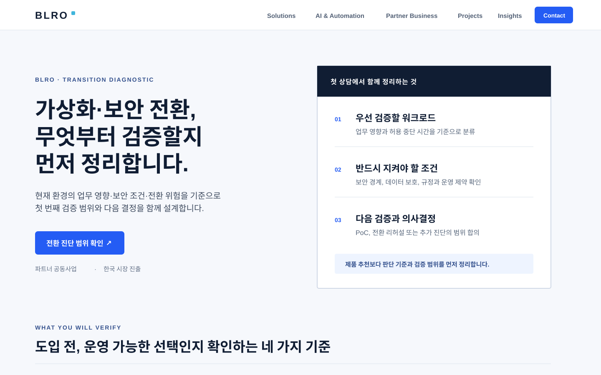

# BLRO 마케팅·사용자 전환 개선 계획

> 작성일: 2026-07-15  
> 성격: 기존 `website-expansion-plan.md`를 대체하지 않는 별도 실행 계획  
> 대상: `blro.co.kr` 공개 웹사이트의 기업 고객 리드 전환 흐름

## 1. 목적과 판단 원칙

BLRO 홈페이지의 목표는 페이지 조회가 아니라 **전환을 검토 중인 기업 담당자가 자신의 상황에 맞는 첫 대화를 시작하도록 만드는 것**이다.

이 계획은 디자인 유행이나 경쟁사 문구를 복제하지 않는다. 실제 고객 언어, 상담·문의 데이터, 페이지 행동 데이터로 가설을 검증하며 다음 원칙을 지킨다.

- 공개 근거가 없는 고객명, 로고, 도입 성과, 인증을 만들지 않는다.
- 제품 판매보다 `현재 환경에서 무엇을 먼저 검증해야 하는가`를 먼저 답한다.
- 기업 고객, 파트너, 글로벌 벤더의 경로는 유지하되 홈의 주 행동은 기업 고객의 전환 진단으로 명확히 한다.
- 측정 동의 전에는 개인 식별 정보나 행동 분석을 수집하지 않는다.

## 2. 현재 진단 (2026-07-15)

### 확인한 사실

- 운영 페이지 `https://blro-website.pages.dev/`에서 홈, 솔루션, 인사이트, 문의로 이어지는 경로와 모든 주요 제목을 확인했다.
- 첫 화면은 `복잡한 전환을 운영 가능한 선택으로 만듭니다.`라는 명확한 포지셔닝과 세 개의 문의 행동(기술 프로젝트 / 파트너 공동사업 / 한국 시장 진출)을 제시한다.
- 솔루션 영역은 가상화·HCI, 보안·SASE, VDI, 검증·전환을 기술 목록이 아닌 운영 판단 기준으로 설명한다.
- 문의 페이지에는 회사명, 담당자명, 업무용 이메일, 연락처(선택), 상황 설명, 개인정보 동의가 있으며, CTA 클릭 이벤트의 비식별 측정 기반도 존재한다.

### 전환 관점의 진단 점수: 5.6 / 10 (가설 기준)

이 점수는 전환 방법론의 7개 진단 항목을 현재 공개 정보만으로 평가한 초기 가설이다. 실제 방문·상담 데이터가 쌓이면 다시 산정한다.

| 진단 항목 | 현재 판단 | 근거 / 개선 방향 |
| --- | --- | --- |
| 한 가지 주요 행동 | 미흡 | 첫 화면에 세 CTA가 동등하게 보여 기업 고객의 다음 행동이 분산된다. |
| 5초 내 가치 제안 | 양호 | `운영 가능한 선택`의 방향은 명확하나, 첫 상담에서 얻는 결과물이 즉시 보이지 않는다. |
| 고객 이탈 이유 조사 | 미확인 | 아직 상담 녹취·이탈 설문·문의 손실 사유가 없다. |
| 반론-근거 표 | 미흡 | 비용, 기존 VMware 환경, 중단 위험, 보안·규정, 수행 책임에 대한 근거 배치가 필요하다. |
| 설득 자산 | 부분 충족 | 공개 인사이트와 수행 절차는 있으나, 진단 산출물 예시·익명화 사례·기준표가 부족하다. |
| 퍼널 측정 | 부분 충족 | CTA 이벤트 기반은 있으나 단계별 전환 기준과 정례 리뷰가 없다. |
| UX 마찰 | 부분 충족 | 문의 양식은 간결하지만 운영 환경상 안전한 접수 연결 상태를 계속 확인해야 한다. |

## 3. 우선순위 개선 백로그

### P0 — 첫 방문자의 다음 행동을 하나로 모으기

**목표:** 기업 고객이 5초 안에 `BLRO가 무엇을 정리해 주는지`와 `지금 할 행동`을 이해한다.

1. 홈 히어로의 주 CTA를 `전환 진단 범위 확인`으로 통일한다.
2. 같은 자리에서 첫 상담 산출물 3가지를 짧게 보여 준다.
   - 우선 검증할 워크로드와 제외 범위
   - 업무 중단·보안·복구 조건의 확인 항목
   - PoC 또는 전환 리허설의 다음 결정
3. 파트너·벤더 CTA는 보조 경로로 내리고, 명확한 대상 레이블을 붙인다.
4. CTA 클릭 → 문의 → 접수 완료를 하나의 `기업 고객 전환` 퍼널로 측정한다.

**가설:** ‘기술 프로젝트 상담’보다 산출물이 보이는 CTA가 문의 시작률을 높인다.  
**성공 지표:** 기업 고객 CTA 클릭률, 문의 양식 시작률, 유효 문의 접수율.  
**가드레일:** 파트너·벤더 문의 수와 모바일 접근성은 감소시키지 않는다.

### P1 — 고객의 다섯 가지 반론을 근거로 답하기

고객 인터뷰 전에는 아래를 `가설`로만 취급한다. 표현·배치는 실제 상담과 이탈 이유로 검증한다.

| 예상 반론 | 페이지에서 제공할 실제 근거 | 배치 |
| --- | --- | --- |
| 우리 환경에도 맞는가 | 워크로드·업무 영향·기존 운영 제약을 기준으로 보는 진단 범위 | 히어로 직후 |
| 기존 가상화 환경을 무리하게 바꾸는 것은 아닌가 | 유지·전환·혼합 운영을 열어 둔 비교 기준과 제외 범위 | HCI / 마이그레이션 페이지 |
| 중단과 복구 위험은 누가 책임지는가 | PoC 통과 기준, 전환 리허설, 롤백·운영 인수 조건 | 솔루션 상세 / 문의 직전 |
| 보안·규정 조건을 놓치지 않는가 | 접근 흐름, 정책 매트릭스, 데이터 보호 확인 항목 | 보안 컨설팅 / SASE 페이지 |
| 상담 후 무엇을 받는가 | 첫 대화 후 정리되는 진단 요약의 익명화 샘플 | 홈 / 문의 페이지 |

### P2 — 신뢰를 ‘고객 로고’가 아닌 공개 가능한 수행 증거로 만들기

- **전환 진단 요약 예시:** 고객 정보가 없는 1페이지 샘플. 입력 조건 → 판단 기준 → 다음 검증 순서만 공개한다.
- **익명화 사례 카드:** 실제 공개 승인을 받은 후에만 산업, 과제, 고려 조건, 수행 범위, 확인된 결과를 맥락과 함께 작성한다.
- **실무 인사이트 연결:** 각 솔루션 페이지에서 관련 인사이트 하나와 체크리스트 하나를 연결한다.
- **비교 자료의 역할 분리:** VMware·Nutanix 비교는 미공개 판단 자료로 유지하고, 공개 페이지는 중립적 평가 기준만 다룬다.

### P3 — 데이터 기반 반복 운영

1. 매주: CTA별 클릭, 문의 시작, 접수, 상담 전환을 한 장의 표로 검토한다.
2. 매월: 상담·미전환 문의에서 반복된 표현과 반론을 익명화해 반론-근거 표를 갱신한다.
3. 분기: 홈 히어로 또는 진단 산출물 제시 방식을 한 번에 한 가설씩 비교한다. 충분한 표본과 한 업무 주기를 확보하기 전에는 승패를 선언하지 않는다.

## 4. 예상 첫 화면

아래 이미지는 개발 전 합의용 와이어프레임이다. 실제 고객 사례나 성과 수치를 의미하지 않는다.

### 변경 핵심

- 기존의 `전환을 운영 가능한 선택으로`라는 브랜드 방향은 유지한다.
- 주 메시지를 기업 담당자의 즉시 과제인 `무엇부터 검증할지`와 연결한다.
- 버튼의 목적을 상담 자체가 아니라 진단 범위 확인으로 구체화한다.
- 오른쪽에는 제품 이미지가 아니라 첫 상담에서 정리되는 판단 항목을 보인다.
- 파트너·벤더 경로는 히어로 하단의 보조 링크 또는 대상별 영역으로 이동한다.

## 5. 실행 순서와 완료 기준

| 순서 | 작업 | 완료 기준 |
| --- | --- | --- |
| 1 | 측정 기준 확정 | 기업 고객 CTA / 문의 시작 / 접수 / 유효 상담의 정의가 문서화된다. |
| 2 | P0 카피·정보 구조 구현 | 주 CTA 1개, 산출물 3개, 대상별 보조 경로가 실제 화면에 반영된다. |
| 3 | P1 반론-근거 블록 구현 | 공개 가능한 근거만으로 비용·적합성·위험·보안·다음 단계의 질문에 답한다. |
| 4 | 진단 요약 샘플 제작 | 비식별·비고객 정보로 된 공개용 샘플 1개가 검토·승인된다. |
| 5 | 실제 사용자 검증 | 기업 고객 3~5명에게 5초 이해도와 첫 행동을 확인한다. |
| 6 | 정례 리뷰 시작 | 첫 주 기준선과 다음 실험 가설이 기록된다. |

## 6. 현재 결정이 필요한 항목

다음 구현 전에만 결정한다.

1. **주 전환 대상:** 홈의 최우선 대상은 ‘전환을 검토 중인 기업 고객’으로 둔다.
2. **공개 가능한 증거:** 고객명 없이 공개 가능한 수행 방식, 산출물 예시, 익명화 사례의 범위.
3. **상담 SLA:** ‘접수 후 언제 어떤 방식으로 회신하는가’의 실제 기준. 약속할 수 있을 때만 페이지에 표시한다.

## 7. 다음 구현 단위

첫 구현 단위는 P0만이다. 기존 페이지의 메시지와 전체 계획을 뒤집지 않고, 홈 히어로·CTA·첫 상담 산출물 영역·측정 이벤트만 조정한다. P1 이후는 실제 상담 데이터 또는 공개 승인 근거가 확보된 뒤 진행한다.
